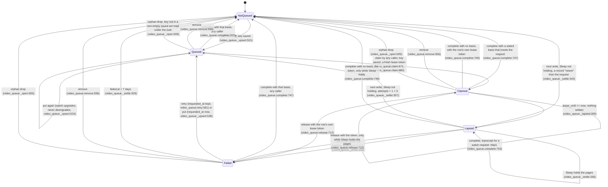

# The video queue's lease lifecycle, as the code implements it

Drawn from the code at the sync commit in `SKILL.md`, before the model was written, and redrawn for ruling 34
(2026-10-22: a per-claim lease token, the saved videos read under the lock, a lease cap). Every citation is
`<module>.<function>:<line>`, and `coverage.py` fails when a line falls outside the function it names.

## One video's row

`Lapsed` is not a value in the file. The file still says `claimed`; every reader settles it in memory
(`video_queue.view:392`, `video_queue._open:500`) and only a write persists the settlement. While Sleep holds the
pages a lapsed lease is left as it is, so it reads as claimed again. When Sleep does not hold them, every write
settles a lapsed lease first, so `release` and the no-basis `complete` reach a lapsed row only while Sleep holds.

## Every transition

| # | From | To | Trigger | Guard | Code |
|---|---|---|---|---|---|
| 1 | not queued | queued | person queues (PUT `/videos/queue/{key}`, POST `/videos/run/handoff`) | key in the saved set, read under the lock | `video_queue._upsert:521`, `video_queue.put:540`, `video_queue.handoff:609`; `videos._put:137`, `videos._handoff:180` |
| 2 | queued | queued | person queues again | `want=watch` upgrades; a transcript never downgrades | `video_queue._upsert:524` |
| 3 | queued | claimed | `cicada_video_claim`, `cicada video claim` | state `queued` and key in the saved set; oldest first; at most `min(limit or 5, 10)`; the caller's session id is stored only when it has one, cut to 80 characters; a fresh 128-bit lease token, returned on the video's reply line | `video_queue.claim:671`, `video_queue.claim:679`, `video_queue.claim:680`; `mcp_tools.video_claim:1249` |
| 4 | claimed | claimed, lease extended | a claim, release or complete whose session id equals the stored one | lease not lapsed; a caller with no id refreshes nothing; never past `MAX_LEASE_PERIODS` (3) lease periods from `claimed_at` (F4) | `video_queue._refresh:644`, `video_queue._lease_cap:629`, called at `video_queue.claim:670`, `video_queue.release:699`, `video_queue.complete:750` |
| 5 | claimed | lapsed | time passes `lease_until` | none; nothing is written | `video_queue._lapsed:300` |
| 6a | lapsed | not queued (done) | the next write | Sleep not holding; a record at or after `requested_at`, read to the second, meets the request | `video_queue._settle:342`; `video_state.newer_than:239` |
| 6b | lapsed | queued, attempts + 1 | the next write | Sleep not holding; attempts + 1 < 3 | `video_queue._settle:357` |
| 6c | lapsed | failed (`failed`, derived reason) | the next write | Sleep not holding; attempts + 1 = 3 | `video_queue._settle:353` |
| 6d | lapsed | lapsed | the next write | Sleep holds the pages (`mcp_tools.ToolContext.pages_held:209`) | `video_queue._settle:336` |
| 7 | claimed (lapsed only while Sleep holds) | failed (code, scrubbed reason) | `cicada_video_claim(release=[{url, lease_token, code, reason}])` | state `claimed` and the item's `lease_token` is the row's (F1); otherwise `not_yours`, and a row with no token (claimed before ruling 34) is never released, it lapses | `video_queue.release:712`, `video_queue._token_matches:652`; `mcp_tools.video_claim:1230` |
| 8 | any row | not queued (done) | `cicada_record_watch` credits the queue | basis `frames`/`both`, or `transcript` for a transcript request; **any caller, any state, any record age** (F3, accepted) | `video_queue.complete:747`; `mcp_tools.record_watch:651`, `mcp_tools._credit_video_queue:1127` |
| 9 | claimed (lapsed only while Sleep holds) | not queued (done) | `cicada_record_watch` with no basis | the call's `lease_token` is the row's (F5) | `video_queue.complete:749` |
| 10 | claimed | claimed | `cicada_record_watch(basis=transcript)` on a watch request | none: the row stays | `video_queue.complete:753` |
| 11 | failed | queued, attempts 0 | Try again (POST `.../retry`), or queue again | retry keeps `requested_at`; put restarts it | `video_queue.retry:581`, `video_queue._reset:513`; `video_queue._upsert:528` |
| 12 | failed | not queued | the next write | `failed.at` + 7 days <= now | `video_queue._settle:329` |
| 13 | any row | not queued | person removes (DELETE `/videos/queue/{key}`) | none | `video_queue.remove:556`; `videos.delete_video_queue:151` |
| 14 | any row | not queued | any write | the writer's saved set, read under its lock, is non-empty and lacks the key | `video_queue._drop_orphans:375`, `video_queue._open:505` |

## What is atomic, and what is not

- **Atomic: one locked read-modify-write.** `put`, `remove`, `retry`, `handoff`, `claim`, `release` and
  `complete` each read the file (`video_queue._read_file:216`), settle, drop orphans, change rows and write under
  one exclusive `fcntl.flock` on the sidecar `<bank>.json.lock` (`video_queue._locked:256`). The write is a temp
  file plus `os.replace` (`video_queue._write:270`), so a crash before the rename writes nothing and a crash after
  it is a complete write. Each call opens its own lock file description, so the lock excludes threads of one
  process as well as other processes. The model makes each of these one step.
- **Under the lock since ruling 34: the saved videos.** Every writer reads them inside its lock (fix F2):
  `video_queue.put:539`, `video_queue.remove:555`, `video_queue.retry:575`, `video_queue.handoff:608`,
  `video_queue.claim:668`, `video_queue.release:698`, `video_queue.complete:739`. The MCP handler reads them again
  after the claim, for its reply lines only (`mcp_tools.video_claim:1255`). Before the ruling each writer read them
  before its lock, and a video saved and queued meanwhile could be dropped as an orphan (finding F2).
- **Not under the lock: the clock.** Every writer reads `now` before it locks. The model splits each call into a
  snapshot step and a locked step, fuses them when the snapshot cannot be stale, and times the locked step at the
  lock (see SKILL.md, abstractions).
- **Not one step: a record and its queue credit.** `record_watch` writes the episode and its claim
  (`mcp_tools.record_watch:635`), may commit (`mcp_tools.record_watch:642`), and only then calls
  `_credit_video_queue` (`mcp_tools.record_watch:651`), which swallows any exception
  (`mcp_tools._credit_video_queue:1132`). The model splits a record into the episode write, the credit's start and
  the locked credit, and lets the credit never run.
- **Readers take no lock.** `video_queue.view:391` reads one whole file (the rename makes it old or new, never
  half) through a parse cache keyed by `(mtime_ns, size)` and settles in memory. The model folds readers into the
  settled view every locked step starts from.
- **Inside the lock: the Sleep probe.** `holding()` is asked lazily inside `_settle` (`video_queue._settle:336`),
  under the lock. On stdio it is an HTTP probe with a 2 s timeout (`mcp_tools._backend_sleep_running:69`), so a
  writer holds the queue lock for up to 2 s when the backend is slow to answer.

## Actors

- **The person**, through the backend's routes (`api/routers/videos.py`), which run in a thread pool.
- **Agent callers**, each carrying a session id that the queue stores at claim and uses only to refresh that
  caller's leases. Since ruling 34 nothing ends a lease by the id: a release, and a record with no basis, need the
  claim's lease token. The id is not always stable or unique, which is why:
  - A Claude Code session, or any harness that sets `CICADA_SESSION_ID`, has one stable id
    (`session_identity.parse:47`).
  - A stdio MCP server under any other harness mints `ses_<date>_<hex>` per process
    (`session_identity.stdio_identity:61`), so a restarted process has a new id and no longer refreshes its own
    leases (its conversation still holds their tokens).
  - `cicada video claim` from the CLI with no harness id runs with session id `""`
    (`cli._tool_context:242`, `cli_app.door:313`, `tool_door.Caller:59`), so nothing is stored and nothing is
    refreshed; the token still hands its leases back.
  - Every remote conversation that omits its `conversation` handle shares one id per connector per day
    (`runtime.resolve_handle:75`), so two such conversations refresh each other's leases (bounded by the cap) but
    cannot end them.
  - An id longer than 80 characters is stored cut (`video_queue.claim:679`) while every later compare uses the
    whole id, so it refreshes nothing, exactly like no id.
- **Sleep**, which holds the pages through `write_admission`. The queue only asks whether it does.
- **Time.** Leases are 45 minutes (`video_queue.LEASE_MINUTES:65`), refreshed at most to three lease periods from
  the claim (`video_queue.MAX_LEASE_PERIODS:67`), failed rows age out after 7 days
  (`video_queue.EXPIRE_FAILED_DAYS:74`), three lapses fail a row (`video_queue.MAX_ATTEMPTS:68`). A request's
  `requested_at` is kept to the second (`video_queue._iso:149`), an episode's timestamp to the microsecond
  (`episode_ids.utc_now_iso:221`), and `video_state.newer_than:239` compares them with `>=`.
