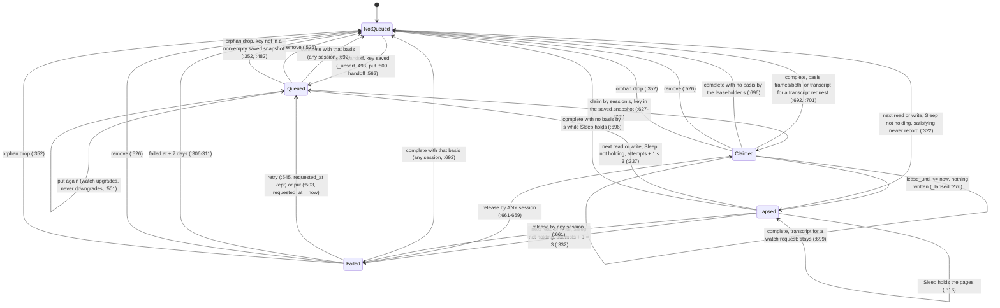

# The video queue's lease lifecycle, as the code implements it

Drawn from the code at the sync commit in `SKILL.md`, before the model was written. Line numbers are
`api/services/video_queue.py` unless another file is named.

## One video's row

`Lapsed` is not a value in the file. The file still says `claimed`; every reader settles it in memory
(`view` :368, `_open` :474) and only a write persists the settlement. While Sleep holds the pages a
lapsed lease is left as it is, so it reads as claimed again.

## Every transition

| # | From | To | Trigger | Guard | Code |
|---|---|---|---|---|---|
| 1 | not queued | queued | person queues (PUT `/videos/queue/{key}`, POST `/videos/run/handoff`) | key in the saved snapshot | `_upsert` :493-500, `put` :509-523, `handoff` :562-599; `api/routers/videos.py:137,180` |
| 2 | queued | queued | person queues again | `want=watch` upgrades; a transcript never downgrades | `_upsert` :501-502 |
| 3 | queued | claimed(s) | `cicada_video_claim` | state `queued` and key in the saved snapshot; oldest first; at most `min(limit or 5, 10)` | `claim` :613-638; `mcp_tools.py:1222` |
| 4 | claimed(s) | claimed(s), lease extended | any claim, release or complete by session s | lease not lapsed | `_refresh` :602-610, called at :626, :651, :697 |
| 5 | claimed | lapsed | time passes `lease_until` | none; nothing is written | `_lapsed` :276-280 |
| 6a | lapsed | not queued (done) | the next read or write | Sleep not holding; a record newer than `requested_at` satisfies the request | `_settle` :315-328; `video_state.satisfies` :242 |
| 6b | lapsed | queued, attempts + 1 | the next read or write | Sleep not holding; attempts + 1 < 3 | `_settle` :329-337 |
| 6c | lapsed | failed (`failed`, derived reason) | the next read or write | Sleep not holding; attempts + 1 = 3 | `_settle` :332-335 |
| 6d | lapsed | lapsed | the next read or write | Sleep holds the pages (`ToolContext.pages_held`, `mcp_tools.py:209`) | `_settle` :316 |
| 7 | claimed or lapsed, any holder | failed (code, scrubbed reason) | `cicada_video_claim(release=[{url, code, reason}])` | state `claimed`; **the caller's session is not compared** | `release` :641-671; `mcp_tools.py:1206` |
| 8 | any row | not queued (done) | `cicada_record_watch` credits the queue | basis `frames`/`both`, or `transcript` for a transcript request; **any session, any state, any record age** | `complete` :674-708 (:692-694); `mcp_tools.py:629,1104` |
| 9 | claimed(s) or lapsed(s) | not queued (done) | `cicada_record_watch` with no basis | caller is session s | `complete` :696 |
| 10 | claimed | claimed | `cicada_record_watch(basis=transcript)` on a watch request | none: the row stays | `complete` :698-700 |
| 11 | failed | queued, attempts 0 | Try again (POST `.../retry`), or queue again | retry keeps `requested_at`; put restarts it | `retry` :545-559, `_reset` :487; `_upsert` :503-505 |
| 12 | failed | not queued | the next read or write | `failed.at` + 7 days <= now | `_settle` :306-311 |
| 13 | any row | not queued | person removes (DELETE `/videos/queue/{key}`) | none | `remove` :526-542 |
| 14 | any row | not queued | any write | the writer's saved snapshot is non-empty and lacks the key | `_drop_orphans` :352-362, `_open` :482 |

## What is atomic, and what is not

- **Atomic: one locked read-modify-write.** `put`, `remove`, `retry`, `handoff`, `claim`, `release`
  and `complete` each read the file (`_read_file` :194), settle, drop orphans, change rows and write
  under one exclusive `fcntl.flock` on the sidecar `<bank>.json.lock` (`_locked` :229-240). The write
  is a temp file plus `os.replace` (`_write` :243-256), so a crash before the rename writes nothing
  and a crash after it is a complete write. Each call opens its own lock file description, so the
  lock excludes threads of one process as well as other processes. The model makes each of these one
  step.
- **Not under the lock: the saved snapshot.** Every writer reads the saved videos before it locks:
  `_saved` at put :514, remove :529, retry :549, handoff :582, claim :623, release :647, complete :682,
  and the MCP handler passes its own snapshot from `mcp_tools.py:1204`. The model splits each call
  into a snapshot step and a locked step.
- **Not one step: a record and its queue credit.** `record_watch` writes the episode and its claim
  (`mcp_tools.py:613`), may commit (:620), and only then calls `_credit_video_queue` (:629), which
  swallows any exception (:1107). The model splits a record into the episode write and the credit, and
  lets the credit never run.
- **Readers take no lock.** `view` :368, `stamp` :388 and `next_change_at` :420 read one whole file
  (the rename makes it old or new, never half) through a parse cache keyed by `(mtime_ns, size)`
  (:213-226) and settle in memory. The model folds them into the settled view every locked step
  starts from.
- **Inside the lock: the Sleep probe.** `holding()` is asked lazily inside `_settle` (:316), under
  the lock, so the answer and the write belong to one step.

## Actors

- **The person**, through the backend's routes (`api/routers/videos.py`), which run in a thread pool.
- **Agent sessions**, each a stdio MCP server process keyed by the harness's session id, or the remote
  connector's runtime inside the backend. A restarted process keeps its session id.
- **Sleep**, which holds the pages through `write_admission`; the queue only asks whether it does.
- **Time.** Leases are 45 minutes (`LEASE_MINUTES` :53), failed rows age out after 7 days
  (`EXPIRE_FAILED_DAYS` :60), three lapses fail a row (`MAX_ATTEMPTS` :54).
