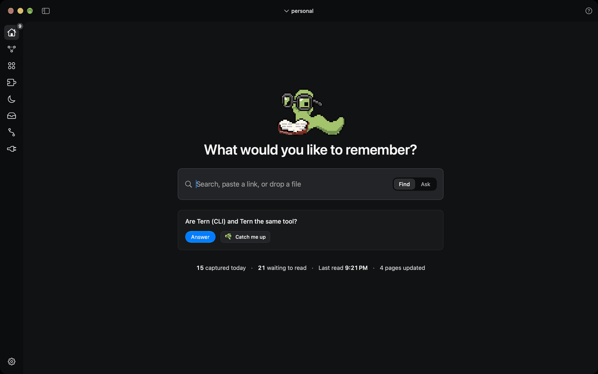
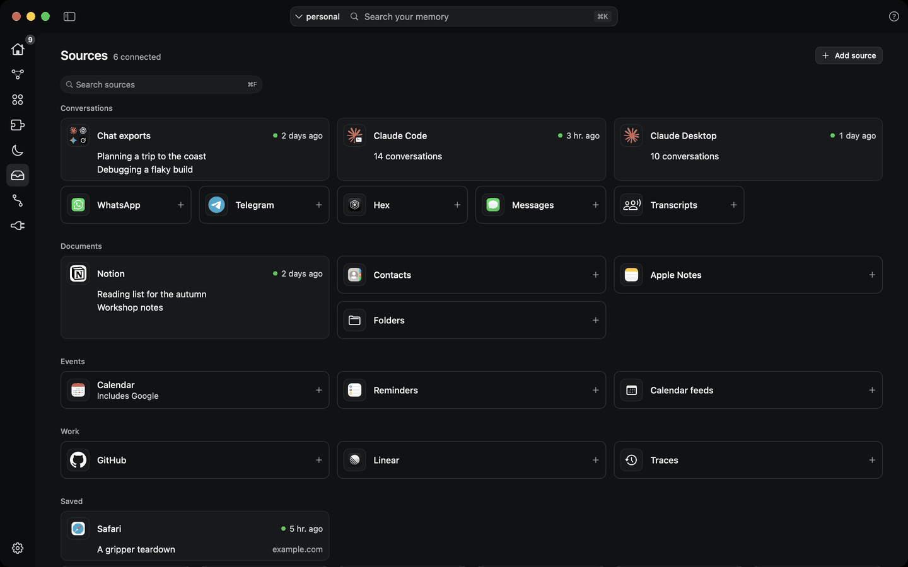
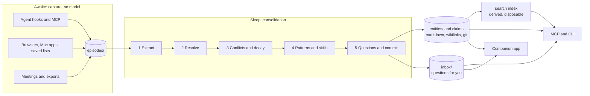
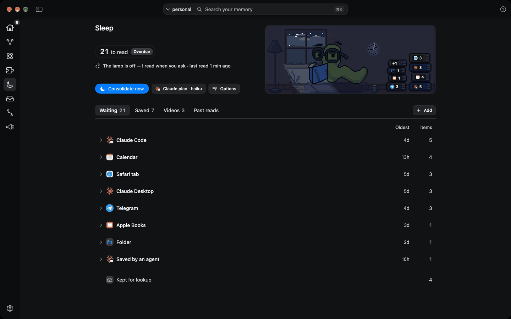

<p align="center">
  
</p>

<h1 align="center">Cicada</h1>

<p align="center">
  <strong>Memory for you and your agents: what you read, save, decide and talk about, kept as plain markdown you can read.</strong>
</p>

<p align="center">
  <a href="https://github.com/rorosaga/cicada/releases/latest"></a>
  <a href="LICENSE"></a>
  
  
</p>

<p align="center">
  <a href="#install">Install</a> ·
  <a href="#connect-your-agents">Connect an agent</a> ·
  <a href="#how-it-works">How it works</a> ·
  <a href="#measured">Benchmarks</a> ·
  <a href="docs/architecture">Docs</a> ·
  <a href="docs/goals/memory-evolution.md">Backlog</a> ·
  <a href="https://github.com/rorosaga/cicada/releases">Releases</a> ·
  <a href="https://github.com/rorosaga/cicada/issues">Issues</a>
</p>

<p align="center">
  
</p>

## Install

On an Apple silicon Mac with macOS 14 or later:

```sh
curl -fsSL https://raw.githubusercontent.com/rorosaga/cicada/main/scripts/install-release.sh | bash
```

This installs the latest release into `~/Applications` and opens it. The app carries its own Python, git and a small
search model, so nothing else is needed, and it updates itself.

Cicada reads your conversations into memory with an engine you choose: a signed-in Claude Code or Codex plan, or an API
key you add in Settings. If you have neither, the app shows the one line that installs one.

**Not notarized yet.** The `curl` line above sets no quarantine flag, so macOS opens the app. If you download the zip
from [Releases](https://github.com/rorosaga/cicada/releases) instead, macOS blocks it once: System Settings, Privacy &
Security, then **Open Anyway**. Until the app is signed by Apple, macOS may ask again after an update for permissions you
gave it (Full Disk Access, Contacts, Calendar). How releases are cut: [`docs/RELEASING.md`](docs/RELEASING.md).

<details>
<summary><strong>A server (Linux), Homebrew, or from source</strong></summary>

**Linux with systemd, no app.** Run as the user who will own the memory. It needs `git`, `curl` and
[uv](https://github.com/astral-sh/uv), and says which one is missing.

```sh
curl -fsSL https://raw.githubusercontent.com/rorosaga/cicada/main/scripts/install-server.sh | bash
```

The service binds to `127.0.0.1` only. Run the same line to update; add `-s -- --uninstall` after `bash` to remove
everything but the memory. Reaching it from your other machines: [`docs/architecture/headless.md`](docs/architecture/headless.md).

**Homebrew** (Mac or Linux): the backend, the `cicada` command and the MCP server, without the app.

```sh
brew tap rorosaga/cicada https://github.com/rorosaga/cicada
brew install rorosaga/cicada/cicada
cicada-setup
```

**From source.** Needs Python 3.12, [uv](https://github.com/astral-sh/uv) and the Xcode command line tools.

```sh
git clone https://github.com/rorosaga/cicada.git && cd cicada
./install.sh     # venv, memory folder, MCP registration, background service
make dev         # build the app, install it, launch
make doctor      # health checks, any time
```

`install.sh` is idempotent. Read [`CLAUDE.md`](CLAUDE.md) before changing anything. Never `swift run` the app: it has no
bundle, so its window never takes focus.

</details>

The first launch opens a short setup: who reads your memory, which agents you use, what to bring in. Or choose *Try the
demo* to look around first. Settings, then General, then *Run setup again* brings it back.

## Connect your agents

Cicada is the memory; the chat is where you use it. Agents reach it over [MCP](https://modelcontextprotocol.io).

**Claude Code** has a plugin: the memory tools, the `cicada` skill, and hooks that save each session and add what
Cicada remembers before you ask.

```
/plugin install cicada --marketplace rorosaga/cicada
```

Leave the plugin's settings empty if the app is installed. From a source checkout, set `cicada_repo` to the checkout.

**Everything else** is on the app's Agents page (⌘9). Each row shows how that agent connects and gives you the setup
text to paste into it. The catalogue today:

| How it connects | Agents |
|---|---|
| Hooks that save every turn, plus MCP | Claude Code, Codex, Cursor, Gemini CLI, T3 Code |
| MCP on this Mac | Claude Desktop, OpenCode, Hermes, OpenClaw, Grok Build, GitHub Copilot, Zed, Devin, Warp, Amp |
| Through the remote connector | claude.ai and ChatGPT, on the web and the phone |

A hook is what saves a session, so capture never depends on a model remembering to call a tool. Apps with no hook relay
their turns through one tool instead. The remote connector is off by default, serves only the memory tools on its own
port, and goes through an address you open yourself: [`docs/connect-remote-apps.md`](docs/connect-remote-apps.md).

## What it is

Cicada captures what you read, save, decide and talk about, turns it overnight into a versioned graph of plain markdown
files, and shares that graph with any agent you connect. Agents read it, write to it with provenance, and ask you when
they are unsure. The app shows you what they believe, why, and since when.

- **Plain files.** A memory is a folder of markdown with wikilinks, and a git repository. No database, no account.
- **Provenance on every belief.** Each fact points at the words that support it, who recorded it (you or an agent),
  and which conversation it came from. `git blame` on a page answers "who thought this, and why".
- **You decide.** An agent proposes and you dispose. Questions arrive in an inbox you can ignore, and every automatic
  change can be undone.
- **Silence is a signal.** What you stop mentioning fades, gets a "still true?" question, and eventually archives.
  Mention it again and it comes back.

<p align="center">
  
</p>

### What you can bring in

Capture is file I/O with no model call. Your browser and Mac are read by the app and posted as bytes; nothing is
fetched behind a login.

- **Conversations.** Agent sessions through their hooks, claude.ai and ChatGPT through the connector, and exports from
  AI providers. Meetings too: a folder of transcripts from a recorder such as Hex becomes one conversation each.
- **Reading and saving.** Links, articles, papers, bookmarks (Chrome, Safari, Brave, Vivaldi, Comet, Dia), browser tab
  groups, RSS, and saved lists from YouTube, X, Instagram, LinkedIn, Reddit, Pinterest, TikTok, Spotify and Goodreads.
- **On your Mac.** Notes (never a locked one), Calendar, Contacts, Messages and WhatsApp for the chats you tick, Telegram
  by a QR code, watched folders, voice memos, recordings and photos.
- **Books.** Apple Books, Goodreads, or a scanned ISBN: one page per book, highlights word for word.
- **Code.** Your GitHub repositories, as pages, linked to the projects you start.

## How it works

Cicada borrows from how a brain handles a day.



- **Awake** is fast, episodic capture. Every conversation, note or save is a timestamped episode in `episodes/`.
- **Sleep** is slow consolidation, in five stages. It extracts entities and typed claims, resolves them against the
  existing graph, finds contradictions, applies decay, distills recurring patterns into skills, and writes questions to
  your inbox. Each run is a git commit that names the files it touched, the episode that caused it and the engine that
  wrote it. It runs on your own plan or key, on a schedule or on a click.
- **Decay** treats absence as information. A one-off fades by age; something you have talked about many times only fades
  if live conversation goes quiet.
- **The claim layer** holds beliefs as typed predicates with bi-temporal validity, an observer and a trust level, so an
  agent can reason over the record without re-reading prose.

<p align="center">
  
</p>

### Engines

Sleep reads conversations with an engine you choose. **Auto** is the default: your Claude plan, else your ChatGPT plan,
else Cursor, else OpenCode, and it says in words which one runs. You can also pick a plan (Grok too) or an API key from
any provider LiteLLM supports. A local model runs only if you choose one. Scheduled runs use a plan only while
*Scheduled runs may use my plan* is on.

## Measured

Cicada's retrieval is measured on two public benchmarks with the harness in [`benchmarks/public`](benchmarks/public).
All figures below use one small model for both answers and grading, one run each, so a gap of a few questions is
noise. Full tables, methods and the failures: [`docs/research/2026-11-06-memory-before-sleep.md`](docs/research/2026-11-06-memory-before-sleep.md).

**LoCoMo**, 5 long conversations, 200 questions. Answered by `cicada_ask`.

| | Right |
|---|---|
| Nothing read by Sleep yet | 138 of 200 |
| After Sleep | 159 of 200 |
| Whole conversation in the prompt (control) | 167 of 200 |
| No memory | 7 of 200 |

**LongMemEval_S**, 100 questions across every category, nothing slept: 80 right. With no memory 16 were right, and
15 with another person's memory, almost all of them questions where the right answer is "I don't know".

What this does not cover. LoCoMo banks hold 3 to 11 pages. The one larger test, 3,128 conversations, had only 33 pages.
These are retrieval benchmarks, not a test of a real bank at its full size, and no figure compares Cicada with another
product. The tool list's token cost, the languages tried (German, Arabic, Japanese, Chinese) and what was dropped are in the note.

## Privacy and where your data lives

- The memory is a folder on your disk, a git repository you can read, edit and delete. Nothing syncs anywhere unless you
  set it up.
- There is no Cicada cloud. The network is used for your engine's own calls, update checks (on by default, signed and
  verified, switch off in Settings), and fetches you start or enable. Three switches control fetching.
- Secrets live in `~/.cicada/secrets.env` (mode 0600) or the keychain, never in a memory or a log. Locked notes are never read. Numbers you give can be tokenized outside the memory. Text that looks like a secret is
  held back from every engine and shown to you for review.
- The backend binds to `127.0.0.1`. The remote connector, which lets claude.ai and ChatGPT reach your memory, is off until
  you turn it on, uses revocable scoped tokens, and is the only other listener.
- This repository never contains memory content. Test fixtures use placeholder names and every screenshot here comes from
  a synthetic demo bank.

The full list of rules is the "rails" section of [`CLAUDE.md`](CLAUDE.md).

## Why

Two papers frame the design.

**The person's life is the environment.** Silver and Sutton's *Welcome to the Era of Experience* (2025) argues that the
next agents will learn from streams of experience, not snippets of human text. A conversation is a snippet and a life is
a stream. Cicada is the instrument that turns the stream into something an agent can inhabit: every capture is an
observation, every agent write with provenance is an action on a shared record, and every answer you give to a question is
a reward signal from the environment.

**Raw experience, a wiki and skills are three layers.** Tang et al.'s *WikiSkill* (2026) shows that keeping them apart is
what lets agent skills improve and transfer across models. Cicada holds the first two: `episodes/` is the raw layer and
the entity-and-claim graph is the wiki. Compiling what the graph knows about how you work into portable skills is the
third, and it is on the backlog.

So memory has to be legible to an agent without ceremony. Markdown, git, typed claims and MCP all exist for that. Cicada
started as a BSc capstone thesis at IE University and is now an open project with a larger goal: a port between a person's
experience and the agents that will act on it.

## Docs

| Area | Read |
|---|---|
| Capture, the Sleep cycle, decay | [`capture-and-sleep.md`](docs/architecture/capture-and-sleep.md) |
| Markdown and git storage, claims, sources, the telemetry rules | [`storage.md`](docs/architecture/storage.md) |
| The MCP tools, recall, the CLI | [`mcp.md`](docs/architecture/mcp.md) |
| The companion app | [`app.md`](docs/architecture/app.md) |
| The HTTP API, the graph and inbox | [`api.md`](docs/architecture/api.md), [`features.md`](docs/architecture/features.md) |
| Network gates, the remote connector | [`network.md`](docs/architecture/network.md) |
| Running without the app | [`headless.md`](docs/architecture/headless.md) |
| Claude.ai and ChatGPT | [`connect-remote-apps.md`](docs/connect-remote-apps.md) |
| Releases, design rules, research | [`RELEASING.md`](docs/RELEASING.md), [`design`](docs/design/DESIGN_RULES.md), [`research`](docs/research) |
| The backlog and the rulings | [`memory-evolution.md`](docs/goals/memory-evolution.md), [`TODO.md`](docs/goals/TODO.md) |

## Contributing

Cicada is built in the open and pull requests are welcome. Work happens on `dev`: open pull requests against `dev`, not
`main`. A release is a pull request from `dev` to `main`, and merging it tags the version and publishes the release.

Before proposing something, read the backlog in [`docs/goals/`](docs/goals/): one numbered row per idea with its evidence,
and the rulings that are settled. [`CLAUDE.md`](CLAUDE.md) is the engineering manual, including the rails a change must
not break. A change to an area updates that area's doc in the same pull request. Please keep anything personal out of the
repository: no real names, titles, links or quoted conversations, in code, tests, docs or a PR body.

To report a bug, use Help, then *Report a Problem…* in the app. It shows you the report before anything is sent.
Otherwise [open an issue](https://github.com/rorosaga/cicada/issues).

## License

[MIT](LICENSE), © 2026 Rodrigo Sagastegui.
